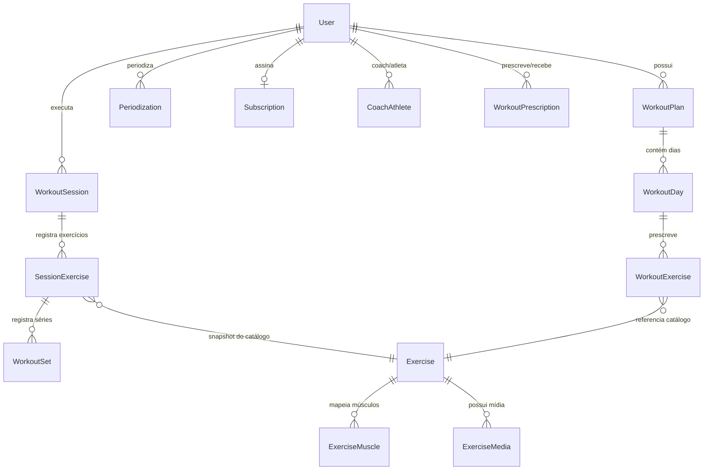

# 🚀 TRAINVY — Visão Geral Completa do Sistema (Master Overview)
> Plataforma SaaS mobile-first para criação, execução, acompanhamento e periodização inteligente de treinos de musculação e força.

---

## 1. Visão de Produto e Proposta de Valor

O **Trainvy** (originalmente concebido sob o codinome *FIT.AI*) é uma plataforma moderna voltada para atletas e treinadores (personal trainers), unindo execução prática na academia a inteligência artificial contextualizada e arquitetura SaaS multiusuário robusta.

### A Fórmula Central do Trainvy
```text
  Metodologia escolhida pelo usuário / treinador
+ Histórico real de treinos executados
+ Contexto e metas atuais
+ Inteligência Artificial contextualizada (sem alucinações no banco)
──────────────────────────────────────────────────────────────────
= Planejamento estruturado, periodização e evolução progressiva
```

Diferente de geradores genéricos de fichas de treino:
1. **Preserva a autonomia metodológica:** Personal trainers e atletas podem usar suas próprias fontes, cadências, divisões musculares e diretrizes.
2. **Separação estrita entre Prescrição e Execução:** Planos e metas planejadas são prescrições; sessões realizadas e séries registradas são fatos históricos imutáveis.
3. **Privacidade e Consentimento (LGPD / GDPR):** O atleta é proprietário exclusivo dos seus dados. Treinadores só visualizam histórico mediante consentimento explícito e com escopo temporal auditável.
4. **Experiência Mobile-First Real:** O atleta utiliza o aplicativo no chão da academia com timer de descanso, histórico de séries anteriores, cálculo automático de volume e suporte a PWA.

---

## 2. Stack Tecnológica e Engenharia

### 2.1. Frontend (`Chiqueto/trainvy-frontend`)
- **Framework:** Next.js 16.1.6 com App Router e Turbopack.
- **Linguagem / Runtime:** TypeScript 5.9 e React 19.2.3.
- **Estilização:** Tailwind CSS 4, shadcn/ui e Radix UI (acessibilidade WAI-ARIA nativa).
- **Ícones:** Lucide React.
- **Comunicação com API:** Cliente HTTP tipado gerado automaticamente via **Orval** (`swagger.json` -> TypeScript Fetch Client).
- **Autenticação:** Better Auth Client com cookies HttpOnly seguros e sincronização via Server Actions.
- **IA Conversacional:** Vercel AI SDK (`useChat`, `DefaultChatTransport`).
- **Gráficos e Estatísticas:** Componentes sob medida para visualização de volume semanal (`WeeklyVolumeChart`) e distribuição muscular (`MuscleDistribution`).
- **PWA Ready:** Manifest, Service Workers e suporte a instalação em dispositivos móveis.

### 2.2. Backend (`Chiqueto/trainvy-api`)
- **Runtime:** Node.js 24.x.
- **Framework Web:** Fastify 5.7.x (alta performance e baixo overhead).
- **Linguagem:** TypeScript 5.9.
- **Banco de Dados e ORM:** PostgreSQL com **Prisma 7.4**.
- **Validação de Contratos:** Zod 4 com `fastify-type-provider-zod`.
- **Autenticação e Sessões:** Better Auth com Google OAuth 2.0 e autenticação por sessão em banco de dados (`session` / `user`).
- **Documentação de API:** Swagger / OpenAPI 3.0 com interface Scalar (`/docs`).
- **Motor de IA:** Vercel AI SDK 6 com Google Gemini 2.5 Flash via Server-Sent Events (SSE).
- **Tratamento de Datas:** dayjs com suporte nativo a timezones IANA.

### 2.3. Padrão Arquitetural do Backend
O backend adota o padrão estrito:
```text
Fastify Route (Zod / OpenAPI) ──▶ Use Case (Regra de Domínio Pura) ──▶ Prisma Client ──▶ PostgreSQL
```
- **Rotas:** Apenas extraem parâmetros, autenticam sessão e delegam para o caso de uso.
- **Use Cases:** Isolam regras de negócio, entitlements, permissões IDOR e transações atômicas.
- **Erros de Domínio:** Mapeamento explícito de exceções para códigos HTTP adequados (400, 401, 403, 404, 409, 500).

---

## 3. Modelo de Domínio e Banco de Dados (PostgreSQL + Prisma)

O schema do banco de dados reflete a separação ontológica entre planejamento, execução, dados comerciais e IA:



### 3.1. Núcleo de Usuário e Segurança
- **`User`:** Identificador único, tipo de conta (`accountType: ATHLETE | COACH`), perfil de sistema (`systemRole: USER | ADMIN`), métricas antropométricas (peso, altura, % gordura, idade) e tema de gamificação.
- **`Session` & `Account`:** Sessões persistentes e provedores OAuth (Google) gerenciados pelo Better Auth.

### 3.2. Prescrição (Planejamento)
- **`WorkoutPlan`:** Plano ou ficha de treino criada pelo usuário ou aceita de uma prescrição. Possui flag `isActive` (apenas 1 plano pode estar ativo por atleta).
- **`WorkoutDay`:** Dia da semana (`WeekDay`), estimativa de duração, indicador de dia de descanso (`isRest`), ordem e imagem de capa.
- **`WorkoutExercise`:** Prescrição do exercício no dia: séries válidas (`sets`), séries de aquecimento (`warmupSets`), repetições-alvo (`reps`), tempo de descanso (`restTimeInSeconds`) e vínculo ao catálogo `Exercise`.
- **`Periodization` & `PeriodizationPlan`:** Planejamento macro/mesociclo com múltiplos blocos de treinos sequenciados com datas de início e fim planejadas.

### 3.3. Execução Real (O Tracker e Fatos Históricos)
- **`WorkoutSession`:** Registro real de um treino executado:
  - Origem (`origin: PLANNED | FREE`).
  - Timestamps precisos (`startedAt`, `completedAt`).
  - **Snapshots Imutáveis:** Grava `workoutPlanNameSnapshot` e `workoutDayNameSnapshot`. Se o usuário alterar ou renomear o plano depois, o histórico original permanece 100% fiel à realidade da época.
  - Invariante de integridade: O sistema bloqueia a abertura de múltiplas sessões ativas simultâneas (`completedAt === null`).
- **`SessionExercise`:** Exercício registrado na sessão com snapshot de nome, ordem e metas planejadas daquele instante.
- **`WorkoutSet`:** Série realizada:
  - Tipo de série (`SetType: WARMUP | WORKING`).
  - Carga registrada em gramas (`weightInGrams` para precisão absoluta), repetições (`reps`), repetições em reserva (`rir`), duração em segundos e notas.

### 3.4. Catálogo Global de Exercícios e Mídia
- **`Exercise`:** Catálogo de exercícios. Se `ownerUserId === null`, trata-se de um exercício canônico global; se preenchido, é um exercício customizado do próprio usuário.
- **`ExerciseMuscle`:** Mapeamento anatômico de músculos trabalhados:
  - `MuscleGroup`: CHEST, BACK, SHOULDERS, BICEPS, TRICEPS, FOREARMS, QUADRICEPS, HAMSTRINGS, GLUTES, ADDUCTORS, HIP_ABDUCTORS, CALVES, CORE.
  - `MuscleRole`: `PRIMARY` (atuante principal direto) e `SECONDARY` (sinergista indireto).
- **`ExerciseMedia`:** Mídia visual associada (RepDB) com imagens WebP de início do movimento e ponto de contração máxima, além de instruções de execução.

### 3.5. Relacionamento Treinador ↔ Aluno (Coach & Athlete SaaS)
- **`CoachInvitation`:** Convite com hash criptográfico seguro, expiração de 48h e uso único gerado pelo treinador.
- **`CoachAthlete`:** Vínculo ativo ou revogado:
  - Status (`status: ACTIVE | REVOKED`).
  - **Consentimento de Evolução (Task 6.3):** `evolutionShared` (booleano de opt-in), `includePreviousHistory` (acesso a treinos prévios ao vínculo), `evolutionSharedAt` e `evolutionRevokedAt`.
- **`WorkoutPrescription` (Task 6.2B):** Prescrição elaborada pelo treinador em formato rascunho (`DRAFT`) ou enviada (`SENT`). O atleta pode aceitar (`ACCEPTED`), gerando um novo `WorkoutPlan` em sua conta, ou recusar (`DECLINED`).

### 3.6. Fundação Comercial e Assinaturas (SaaS)
- **`Plan`:** Planos cadastrados no SaaS (`ATHLETE_FREE`, `ATHLETE_PRO`, `COACH_PRO`, `COACH_TEAM`).
- **`PlanEntitlement`:** Chaves de permissão e cotas atreladas ao plano (`COACH_DASHBOARD`, `MANAGE_ATHLETES`, `ASSIGN_WORKOUTS`, `VIEW_ATHLETE_HISTORY`, `ADVANCED_STATS`, `AI_CHAT`, `AI_PLAN_GENERATION`, `SOURCE_LIBRARY`).
- **`Subscription`:** Assinatura ativa do usuário com snapshots de valor, moeda, status (`ACTIVE`, `TRIALING`, `PAST_DUE`, `CANCELED`) e ponte para gateways (`BillingProvider: NONE | MANUAL | ASAAS`).
- **`AdminAuditLog`:** Trilha de auditoria administrativa para mudanças manuais de planos, concessão ou extensão de períodos de trial.

### 3.7. IA e Auditoria Conversacional
- **`AiConversation` & `AiMessage`:** Histórico de conversas do usuário com o assistente inteligente.
- **`AiToolExecution`:** Registro atômico e idempotente de execução de ferramentas da IA (ex: salvamento de rascunhos de treino sem duplicar chamadas).
- **`AiUsageDaily`:** Rate limit de requisições diárias de IA por usuário.

---

## 4. Módulos Funcionais do Sistema

```text
┌────────────────────────────────────────────────────────────────────────┐
│                                TRAINVY                                 │
├─────────────────┬───────────────────┬──────────────────┬───────────────┤
│    ATLETA       │     TREINADOR     │      MOTOR       │  COMMERCIAL   │
│  EXPERIENCE     │    EXPERIENCE     │    ANALYTICS     │   & ADMIN     │
├─────────────────┼───────────────────┼──────────────────┼───────────────┤
│ • Workout Hub   │ • Painel Alunos   │ • Volume Semanal │ • Planos SaaS │
│ • Tracker Vivo  │ • Prescrição Rem. │ • Distr. Muscular│ • Entitlements│
│ • Histórico Im. │ • Evolução Alunos │ • Recordes (PR)  │ • Trials/Audit│
│ • Coach AI Chat │ • Convite Único   │ • Consistência   │ • Asaas Ready │
└─────────────────┴───────────────────┴──────────────────┴───────────────┘
```

---

### MÓDULO 1: Experiência do Atleta (Workout Hub & Tracker)

1. **Hub Principal (`/` ou `/home`):**
   - Apresenta o treino programado do dia de acordo com o plano ativo e dia da semana.
   - Resumo de consistência semanal (streak e dias treinados).
   - Botão de ação rápida para iniciar o treino do dia ou iniciar treino livre.
2. **Tracker de Treino em Tempo Real (`/workout-sessions/[sessionId]`):**
   - Interface focada em ergonomia móvel para uso com pesos nas mãos.
   - Apresenta séries planejadas (com histórico de cargas da última sessão para facilitar progressão).
   - Diferenciação clara entre séries de aquecimento (`Aq`) e séries válidas (#1, #2).
   - Timer de descanso automático acionado ao concluir uma série.
   - Suporte a adicionar exercícios extras durante a execução.
   - Modal de preview de execução com imagens e instruções RepDB.
3. **Treino Livre (Free Workout):**
   - Permite ao atleta treinar sem um plano rígido pré-estabelecido, selecionando exercícios na hora e registrando séries.
4. **Histórico de Treinos (`/history`):**
   - Listagem cronológica de todas as sessões finalizadas com badges de plano/avulso, duração, volume total e contagem de séries válidas.
   - Detalhe da sessão (`/history/[sessionId]`): visualização completa de tudo que foi registrado no dia.

---

### MÓDULO 2: Motor de Periodização e Planejador (`/planning`)

1. **Gestão de Planos Standalone:**
   - Criação manual ou via IA de divisões clássicas (Push/Pull/Legs, Upper/Lower, ABC, ABCD, Full Body, etc.).
   - Definição detalhada por exercício: séries de aquecimento, séries válidas, faixa de repetições, tempo de descanso em segundos e RIR.
   - Ativação/desativação de plano (garante sempre 1 plano ativo).
2. **Periodizações Estruturadas:**
   - Agrupamento de planos em fases/blocos com metas específicas (ex: Fase 1: Hipertrofia / Fase 2: Força / Fase 3: Deload).
   - Controle de datas planejadas de início e término de cada fase.

---

### MÓDULO 3: Motor de Estatísticas e Análise Muscular (`/stats`)

1. **Volume Semanal (`WeeklyVolumeChart`):**
   - Calcula o volume total de carga levantada (toneladas ou kg) e contagem de séries válidas semana a semana.
   - Agrupamento temporal rigoroso usando o fuso horário (timezone) do usuário para que treinos feitos no domingo à noite não caiam incorretamente na semana seguinte.
2. **Distribuição Muscular Anatômica (`MuscleDistribution`):**
   - Contabiliza as séries válidas realizadas por grupamento muscular.
   - **Séries Diretas:** Quando o músculo é o motor primário (`PRIMARY`).
   - **Séries Indiretas:** Quando o músculo atua como sinergista (`SECONDARY`).
   - Mantém invariante matemática: `totalWorkingSets === classifiedWorkingSets + unclassifiedWorkingSets`.
3. **Evolução por Exercício e PR Oficial:**
   - Busca detalhada de qualquer exercício executado.
   - Cálculo e destaque do **Personal Record oficial (`loadPR`)** baseado no histórico real.
   - Gráfico de evolução de carga ao longo do tempo.
4. **Métricas Corporais:**
   - Registro e acompanhamento da evolução de peso e percentual de gordura.

---

### MÓDULO 4: IA de Treino Contextualizada (Coach AI)

1. **Assistente Especializado via Chat (`/planning` -> Drawer/Chat):**
   - Integrado via Vercel AI SDK e alimentado pelo Google Gemini 2.5 Flash.
   - Capaz de responder dúvidas biomecânicas, sugerir progressão de carga e propor estruturas de treino.
2. **Function Calling Seguro e Idempotente:**
   - A IA **não grava diretamente no banco** estruturas arbitrárias.
   - Executa tools tipadas como `createWorkoutPlanDraft` e `createPeriodizationDraft`.
   - As saídas passam por validação Zod e confirmação do usuário antes de serem persistidas.
   - Tabela `AiToolExecution` garante deduplicação de chamadas em caso de retry.

---

### MÓDULO 5: Ecossistema do Personal Trainer (Coach Portal)

1. **Painel do Treinador (`/personal`):**
   - Exclusivo para usuários com `accountType === "COACH"` e entitlement `MANAGE_ATHLETES`.
   - Monitoramento da cota de alunos (ex: 3 de 5 vagas utilizadas).
   - Gerador de convites seguros via token descartável.
   - Gestão de vínculos ativos com opção de encerramento seguro.
2. **Prescrição de Treinos ao Aluno (`/personal/alunos/[athleteId]/prescrever`):**
   - O treinador monta planos completos personalizados para o aluno.
   - Pode salvar como rascunho (`DRAFT`) ou enviar (`SENT`).
   - O aluno recebe a notificação no app, revisa o plano e aceita (`ACCEPTED`).
   - O plano aceito é inserido na biblioteca do aluno, com ativação voluntária.
3. **Acompanhamento e Histórico de Evolução do Aluno (Task 6.3):**
   - Página do aluno dividida em 3 abas: **Visão Geral | Evolução | Prescrições**.
   - **Consentimento do Aluno (LGPD):** O treinador só visualiza dados se o aluno ativar em seu perfil (`/profile`). Se desligado, retorna HTTP 403 `SHARING_NOT_AUTHORIZED` com orientações passo a passo.
   - **Escopo Temporal:** O aluno escolhe se autoriza histórico retroativo ou apenas treinos a partir do vínculo.
   - **Dashboard do Treinador:** Filtro de período (4, 8, 12 semanas), resumo executivo, gráficos de volume e distribuição muscular idênticos à visão do atleta.
   - **Modal Read-Only de Sessão:** O treinador inspeciona a sessão com snapshot imutável, metas planejadas, séries, cargas, reps e RIR sem possibilidade de alterar ou deletar dados do aluno.
   - **Evolução por Exercício:** Acompanhamento do PR oficial e progressão de força em cada exercício do aluno.

---

### MÓDULO 6: Fundação Comercial e Gestão Administrativa

1. **Planos Comerciais:**
   - Atletas: Gratuito (`ATHLETE_FREE`) e Premium (`ATHLETE_PRO`).
   - Treinadores: Profissional (`COACH_PRO` - até 5 alunos) e Equipe (`COACH_TEAM` - até 25 alunos).
2. **Entitlements em Tempo Real:**
   - Uso de `GetCommercialContext` para validação em milissegundos de permissões antes de qualquer operação sensível de treinador ou de IA.
3. **Painel Administrativo (`/admin`):**
   - Reservado para `systemRole === "ADMIN"`.
   - Consulta de usuários cadastrados e status de assinatura.
   - Concessão manual e extensão de trials de cortesia.
   - Trilha completa de auditoria em `AdminAuditLog`.

---

## 5. Garantias de Segurança, Privacidade e Qualidade

| Princípio | Implementação no Trainvy |
|---|---|
| **Defesa IDOR em Profundidade** | Vínculos de treinador validam explicitamente posse e status ativo. Se um treinador tentar acessar o ID de um aluno que não é dele, o sistema retorna **404 Not Found**, impedindo enumeração maliciosa de IDs. |
| **Consentimento Explícito (Opt-in)** | O compartilhamento de evolução inicia como `false`. O atleta possui controle total e imediato em `/profile` para ligar, desligar ou limitar o histórico temporal. |
| **Isolamento de Métricas Sensíveis** | Peso corporal, altura, percentual de gordura e histórico de chat da IA **jamais são retornados** nos payloads de acompanhamento do treinador. |
| **Cache Seguro** | Todas as rotas de acompanhamento de alunos emitem `Cache-Control: no-store, private`. |
| **Integridade de Fatos Históricos** | Snapshots no momento da conclusão do treino protegem o passado contra renomeações ou exclusões de planos. |
| **Testes Automatizados Contínuos** | **890 testes automatizados** (538 no backend e 352 no frontend) com 100% de aprovação em suítes de integração, concorrência e UI. |

---

## 6. Guia de Estrutura de Arquivos Principais

```text
trainvy/
├── trainvy-api/                               # Backend Fastify + Prisma
│   ├── prisma/
│   │   ├── schema.prisma                      # Schema do banco de dados PostgreSQL
│   │   └── migrations/                        # Histórico de migrações SQL aditivas
│   ├── src/
│   │   ├── domain/                            # Entidades puras e regras de negócio
│   │   ├── errors/                            # Erros tipados de domínio
│   │   ├── lib/                               # Auth (Better Auth), Prisma, AI client
│   │   ├── routes/                            # Plugins Fastify com schemas Zod
│   │   │   ├── coach.ts                       # Gestão de alunos e convites
│   │   │   ├── coach-prescription.ts          # Prescrições de treino
│   │   │   ├── coach-progress.ts              # Acompanhamento e consentimento (Task 6.3)
│   │   │   ├── workout-session.ts             # Tracker e sessões
│   │   │   ├── stats.ts                       # Volume e distribuição muscular
│   │   │   ├── commercial.ts                  # Assinaturas e planos
│   │   │   └── ai.ts                          # Chat e tools de IA
│   │   ├── usecases/                          # Casos de uso da Clean Architecture
│   │   └── scripts/                           # Export OpenAPI, bootstrap, seeds
│   └── tests/                                 # 538 testes de integração com Vitest
│
└── trainvy-frontend/                          # Frontend Next.js 16 + Tailwind 4
    ├── app/
    │   ├── (auth)/                            # Fluxos de login e retorno OAuth
    │   ├── _components/                       # Chat IA, layout, bottom navigation
    │   ├── _lib/api/fetch-generated/          # Cliente HTTP gerado pelo Orval
    │   ├── convite/[token]/                   # Aceite de convite de personal
    │   ├── history/                           # Histórico de treinos do atleta
    │   ├── personal/                          # Portal do Personal Trainer
    │   │   └── alunos/[athleteId]/            # 3 Abas: Visão Geral, Evolução, Prescrições
    │   ├── planning/                          # Planos de treino e periodizações
    │   ├── profile/                           # Perfil e controle de consentimento LGPD
    │   ├── stats/                             # Gráficos de volume e evolução
    │   └── workout-sessions/[sessionId]/      # Tracker de execução vivo
    └── tests/                                 # 352 testes de componentes e UI
```

---

## 7. Status Atual do Projeto e Próximos Passos

O Trainvy possui sua fundação core, motor de tracker, catálogo com mídia, analytics avançada, inteligência artificial contextualizada, motor comercial e o módulo completo de interação entre treinador e aluno (convites, prescrição remota e acompanhamento de evolução com consentimento) **totalmente implementados, testados e validados**.

Os próximos passos naturais mapeados no roadmap contemplam:
1. **Integração do Gateway de Pagamentos Asaas:** Conectar as cobranças de cartão/PIX aos registros de `Subscription`.
2. **Biblioteca de Fontes e Metodologias (RAG):** Upload e indexação de PDFs/artigos para o Coach AI consultar ao montar os planos.
3. **App Mobile Nativo (Capacitor / Expo):** Empacotamento das telas mobile-first para as lojas Google Play e App Store.
